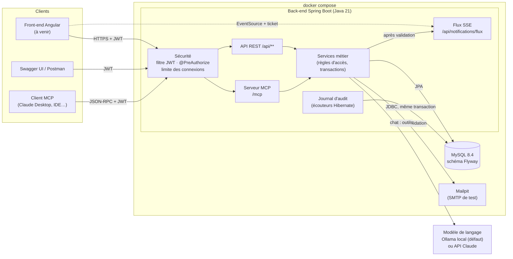
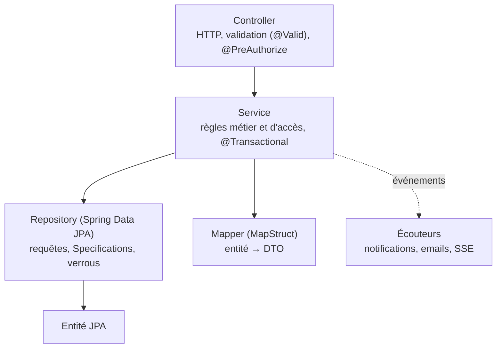
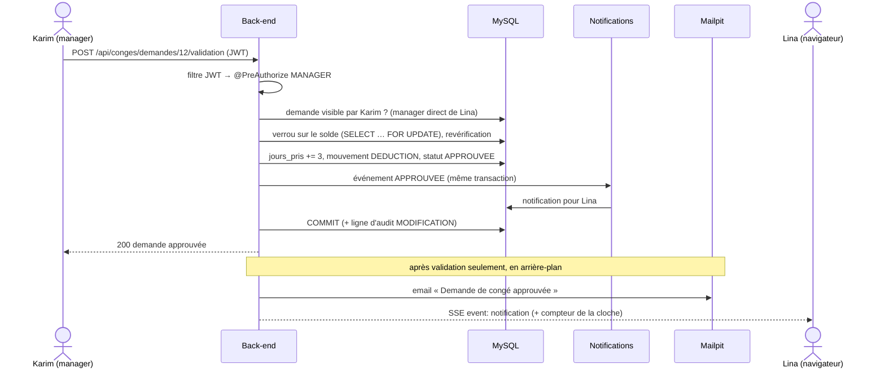
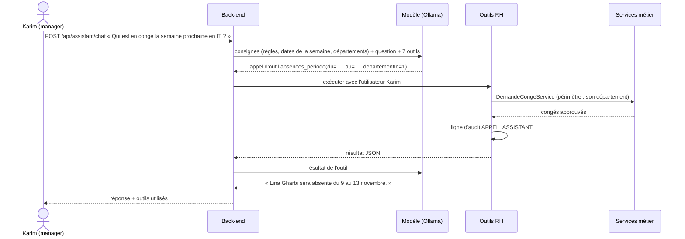
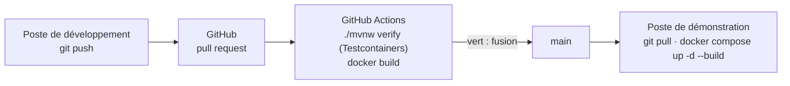

# Architecture

## Vue d'ensemble

- **Une seule application** (monolithe modulaire), découpée par fonctionnalité : `employe`, `departement`, `role`,
  `utilisateur`, `auth`, `conge`, `notification`, `tableaudebord`, `audit`, `assistant`, `mail`, `securite`.
- **Sans état** : aucune session côté serveur ; chaque requête porte son jeton JWT. On peut donc redémarrer
  l'application sans déconnecter personne (seuls les flux SSE ouverts se reconnectent).
- **La base est la source de vérité** : les règles critiques (unicité, soldes positifs, dates) sont aussi des contraintes
  MySQL, et les calculs (tableau de bord) sont faits par des requêtes d'agrégation. Voir [la base de données](base-de-donnees.md).

## Organisation du code

Chaque package suit la même structure en couches :

| Couche | Rôle | Exemple |
|---|---|---|
| Contrôleur | Reçoit la requête, valide le JSON, vérifie le rôle | `DemandeCongeController` |
| Service | Règles métier **et** règles d'accès fines (périmètre du manager, salaire masqué…) | `DemandeCongeService` |
| Repository | Accès aux données, recherches dynamiques, verrous | `DemandeCongeRepository` |
| DTO | Ce que l'API renvoie : jamais les entités elles-mêmes | `DemandeCongeResponse` |
| Événements | Ce qui découle d'une action sans l'alourdir | `DemandeCongeEvenement` → notifications |

Les erreurs sont centralisées (`GestionnaireExceptionsGlobal`) et renvoyées dans un format unique (`ErreurApi`) :
400 données invalides, 401 non authentifié, 403 interdit, 404 introuvable (aussi pour ce qu'on n'a pas le droit de voir),
405 mauvaise méthode HTTP, 415 corps qui n'est pas du JSON,
409 conflit métier, 429 trop de tentatives, 503 service externe indisponible.

## Sécurité

| Mécanisme | Détail |
|---|---|
| Authentification | JWT signé (HS256) : jeton d'accès 15 min + jeton de rafraîchissement 7 jours ; mots de passe BCrypt |
| Révocation | changer de mot de passe incrémente `version_jeton` : tous les jetons émis avant sont refusés |
| Autorisation | `@PreAuthorize` par rôle sur les contrôleurs, puis règles fines dans les services |
| Comptes | invitation par email ; liens d'activation et de réinitialisation à usage unique (empreinte SHA-256 en base) |
| Connexion | 429 après 5 échecs pour un même compte depuis une même adresse IP en 15 minutes |
| Données sensibles | salaire visible des seuls ADMIN/RH et de l'intéressé ; une ressource interdite est « introuvable » (404) |
| Audit | toute création, modification ou suppression d'une entité `@Audited`, avec les anciennes et nouvelles valeurs |
| Production | secrets uniquement par variables d'environnement ; refus de démarrer avec le secret de développement |

Matrice des droits (cahier des charges) :

| Fonctionnalité | ADMIN | RH | MANAGER | EMPLOYÉ |
|---|---|---|---|---|
| Employés : consulter | Tous | Tous | Son département | Son profil |
| Employés : ajouter / modifier / supprimer | Oui | Oui (sauf ADMIN) | — | — |
| Salaires | Oui | Oui | — | Le sien |
| Départements : consulter / gérer | Oui / Oui | Oui / Oui | Oui / — | Oui / — |
| Rôles : gérer | Oui | — | — | — |
| Congés : demander | Oui | Oui | Oui | Oui |
| Congés : valider / refuser | En recours¹ | En recours¹ | Son équipe | — |
| Tableau de bord | Complet | Complet | Son département | — |
| Journal d'audit | Oui | — | — | — |
| Assistant RH | Selon ses droits | Selon ses droits | Selon ses droits | Selon ses droits |

¹ **Le manager d'abord, les RH en recours** : les RH et l'ADMIN voient toutes les demandes, mais ne décident que si
l'employé n'a pas de manager, si son manager ne peut pas agir (compte désactivé, plus de rôle MANAGER), ou si la demande
attend depuis plus de 3 jours (`app.leave.escalation-days`) : elle leur est alors transmise automatiquement, avec un rappel
au manager. Les RH peuvent aussi interrompre un congé approuvé (retour anticipé), motif obligatoire.

## Exemple : la validation d'un congé

Tout ce qui doit être cohérent (solde, historique, notification, audit) est écrit **dans une seule transaction** :
soit tout réussit, soit rien n'est enregistré. Ce qui part vers l'extérieur (email, poussée SSE) n'est envoyé
**qu'après** la validation, pour ne jamais annoncer une décision qui aurait été annulée.

## Exemple : une question à l'assistant RH

- Le modèle **ne voit que ce que l'utilisateur a le droit de voir** : il n'accède jamais à la base, seulement aux outils,
  qui appellent les mêmes services que l'API avec l'utilisateur connecté.
- Les outils sont **en lecture seule** : l'assistant ne peut rien modifier.
- Le même ensemble d'outils est exposé aux clients externes par le **serveur MCP** (`/mcp`), avec le même JWT.
- Moteur au choix : **Ollama** (modèle local gratuit, données sur la machine) ou **l'API Claude** (`ASSISTANT_PROVIDER`).

## Déploiement

| Environnement | Lancement | Configuration |
|---|---|---|
| Développement | `backend/docker-compose.yml` (MySQL, Mailpit) + application lancée depuis l'IDE | `application.yml` (valeurs de développement) |
| Démonstration / production | `docker-compose.yml` à la racine | profil `prod` + fichier `.env` |
| Tests d'intégration | Testcontainers (MySQL éphémère) | propriétés de test, base reconstruite avant chaque test |
