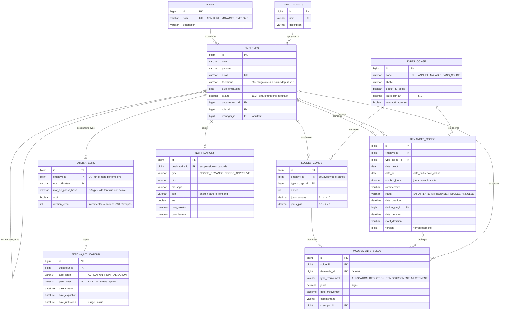
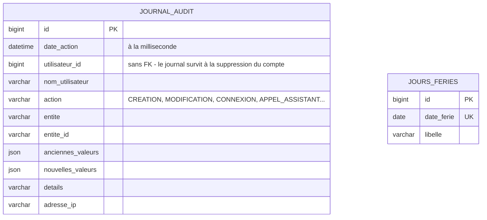

# Base de données

MySQL 8.4. Le schéma est créé et mis à jour uniquement par les migrations Flyway
(`backend/src/main/resources/db/migration`, de `V1` à `V7`) ; Hibernate se contente de le vérifier au démarrage
(`ddl-auto: validate`). Ce diagramme reflète l'état après la dernière migration.

## Diagramme entité-relation

Deux tables sont volontairement **sans clé étrangère** :

## Règles garanties par la base

| Règle | Mécanisme |
|---|---|
| Email d'employé, nom de rôle et de département uniques | contraintes `UNIQUE` |
| Un seul compte par employé | `utilisateurs.employe_id UNIQUE` |
| Un seul solde par employé, type de congé et année | `uk_solde (employe_id, type_conge_id, annee)` |
| Jamais de solde négatif | `CHECK (jours_alloues >= 0 AND jours_pris >= 0)` |
| Dates de congé cohérentes, au moins un jour | `CHECK (date_fin >= date_debut)`, `CHECK (nombre_jours > 0)` |
| Deux décisions simultanées sur une même demande | colonne `version` (verrou optimiste JPA : la seconde reçoit 409) |
| Jetons d'activation et de réinitialisation | seule l'empreinte SHA-256 est stockée ; supprimés avec le compte (`ON DELETE CASCADE`) |
| Historique d'un solde | la somme des mouvements est toujours égale à `jours_alloues - jours_pris` |

## Index

| Table | Index | Sert à |
|---|---|---|
| `demandes_conge` | `(employe_id, date_debut, date_fin)`, `(statut)` | détection des chevauchements, listes filtrées |
| `journal_audit` | `(date_action)`, `(nom_utilisateur)`, `(action)`, `(entite, entite_id)` | filtres de l'écran d'audit |
| `notifications` | `(destinataire_id, lue, date_creation)` | compteur de la cloche, interrogé régulièrement |
| `mouvements_solde` | `(solde_id)` | historique d'un solde |
| `jetons_utilisateur` | `(utilisateur_id)` | invalidation des liens en attente |

## Migrations

| Version | Contenu |
|---|---|
| V1 | Rôles, départements, employés, utilisateurs |
| V2 | Données de départ : 4 rôles, 3 départements, 4 employés |
| V3 | Comptes sans mot de passe (invitation), version des jetons, jetons d'activation / réinitialisation |
| V4 | Journal d'audit |
| V5 | Types de congé, soldes, jours fériés (2026-2028), demandes, mouvements de solde |
| V6 | Reprise : mouvement d'allocation initiale pour les soldes existants |
| V7 | Notifications |
